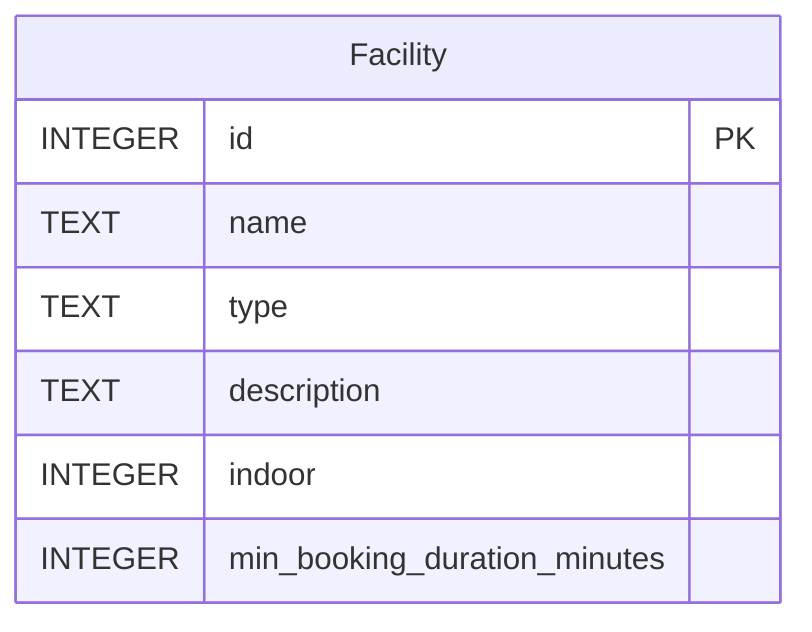
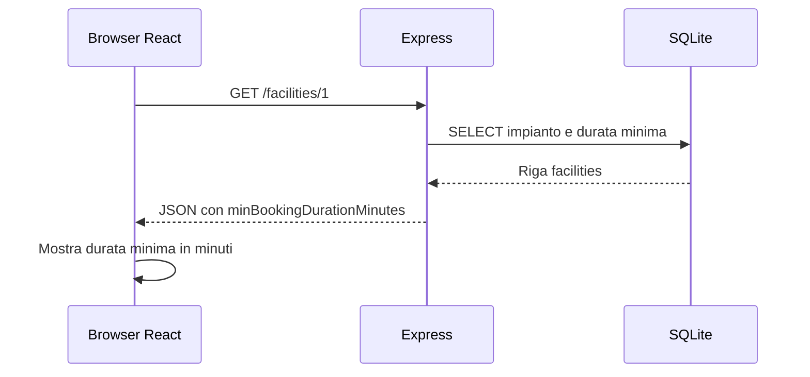

# Lezione 3 — Durata minima

Fonte: L3-slide.pdf, pp. 3 e 6-12.

L’utente consulta nel dettaglio la durata minima prevista per un impianto. Questa modifica espone un dato: non crea ancora prenotazioni né applica regole a prenotazioni inesistenti.

## Impatto e criteri

- DB: campo `min_booking_duration_minutes` intero positivo. Seed: 90/60/60/30 minuti nell’ordine dei quattro impianti iniziali.
- Backend/API: le due GET leggono il campo usando l’alias `minBookingDurationMinutes`.
- Frontend: il dettaglio mostra «Durata minima di prenotazione» e il valore in minuti. Il layout esistente rimane quello della codebase.
- Test: Campo Centrale restituisce 90; l’elenco restituisce le quattro durate; ID inesistente resta 404. Un database della versione precedente viene aggiornato senza perdere righe; ripetere il setup non sovrascrive le durate salvate.

Il setup riconosce la vecchia tabella tramite PRAGMA e aggiunge il campo in una transaction, senza reset. Gli impianti personalizzati preesistenti ricevono il default 60. Il runner versionato è una consegna successiva (L14).

## API reference

`GET /facilities`: 200, array di impianti con gli stessi campi del dettaglio.

`GET /facilities/:id`: 200 con il JSON seguente; 400 per ID malformato, 404 per impianto inesistente.

```json
{
  "id": 1,
  "name": "Campo Centrale",
  "type": "calcio",
  "description": "Campo all’aperto per partite e allenamenti di calcio.",
  "indoor": false,
  "minBookingDurationMinutes": 90
}
```

## ERD



## Flusso del dettaglio


