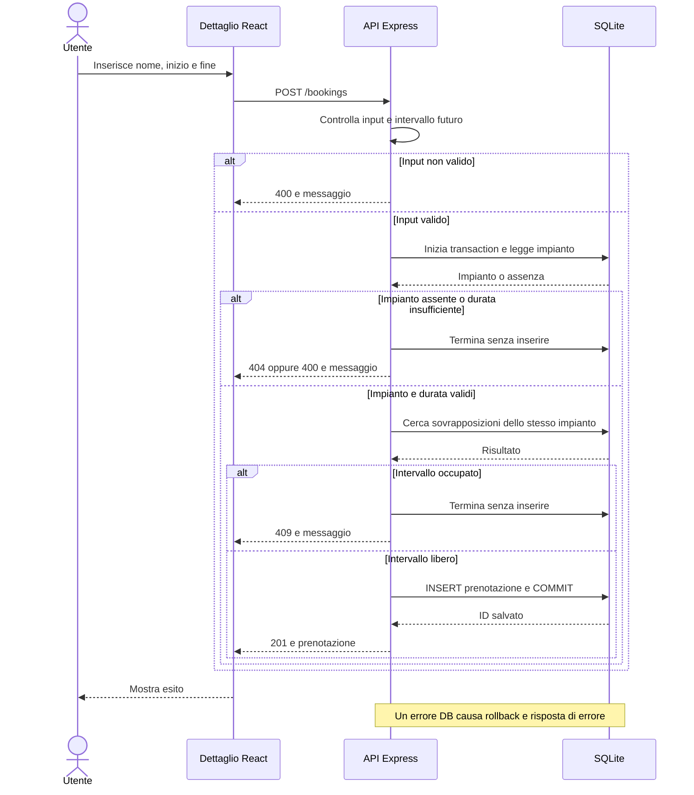
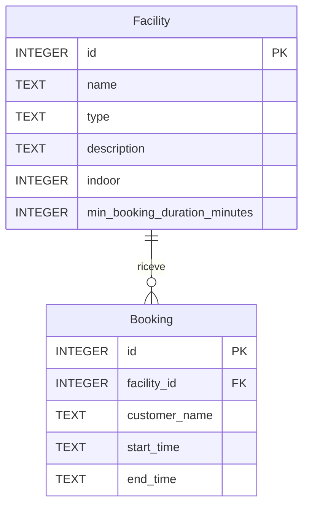

# Lezione 4 - Specifica funzionale delle prenotazioni

Stato: specifica scritta prima del codice. Il successivo incremento la implementa: stato attuale e verifiche in [prenotazioni.md](prenotazioni.md).
Fonte: L4-slide.pdf, pagine 20-21. Il template separato citato nelle slide non è fra i materiali disponibili: questo documento segue gli otto punti della pagina 20.

## 1. Richiesta iniziale

«L’utente deve poter prenotare un impianto.»

La consegna certa della Lezione 4 è produrre la specifica. Le slide rinviano l’implementazione alla Lezione 5. I dettagli seguenti sono decisioni locali esplicite, non regole testualmente imposte dalla consegna.

## 2. User story

Come utente del centro sportivo, voglio prenotare un impianto per un intervallo di tempo, così da riservarne l’uso e ricevere conferma della prenotazione.

## 3. Chiarimenti e decisioni

### Regole scelte per il primo incremento

| ID | Decisione | Motivazione |
| --- | --- | --- |
| R1 | Una prenotazione riguarda un solo impianto esistente e l’intero impianto. | È la versione più semplice della richiesta. La prenotazione di singoli posti è una successiva richiesta esplicita di L11. |
| R2 | Servono impianto, nome del cliente, inizio e fine. Il nome, dopo trim, non può essere vuoto. | I materiali successivi L7/L16 mostrano questi quattro dati. Il nome è dichiarato, non un’identità verificata. |
| R3 | Inizio e fine devono essere istanti validi, con fine strettamente successiva all’inizio. | Un intervallo non valido non riserva tempo. |
| R4 | L’inizio deve essere successivo all’ora del server al momento della richiesta. | Si prenota un uso futuro. |
| R5 | La durata deve essere almeno quella minima dell’impianto introdotta in L3. Una durata esattamente minima è valida; non imponiamo multipli della durata minima. | Diamo significato al dato già presente senza inventare un calendario di slot. |
| R6 | Due prenotazioni dello stesso impianto non possono sovrapporsi. Gli intervalli sono [inizio, fine): una prenotazione può iniziare esattamente quando l’altra termina. | Evita doppie assegnazioni e consente prenotazioni consecutive. |
| R7 | Solo una richiesta accettata crea una prenotazione persistente. Ogni rifiuto lascia invariato l’archivio. La conferma viene mostrata dopo il salvataggio. | Un messaggio di successo deve corrispondere a un dato salvato. |

### Assunzioni e vincoli

- L’attore è considerato noto, come indicato in L4 p. 5. In questa fase non ci sono account, login o verifica del nome dichiarato.
- Nessun pagamento e nessuna approvazione del gestore: una prenotazione valida è confermata immediatamente.
- Nessun orario di apertura è fornito: si accetta qualsiasi intervallo futuro che rispetti R3-R6.
- Il browser raccoglie data e ora locali e invia istanti ISO 8601 con fuso/offset. Il backend confronta gli istanti e li conserva normalizzati in UTC; il browser mostra gli orari locali. Le date prive di fuso sono rifiutate dall’API per evitare interpretazioni diverse fra client e server.
- La disponibilità va ricontrollata al salvataggio. Anche se due richieste arrivano insieme, non devono creare prenotazioni incompatibili. Il confine minimo è lettura delle sovrapposizioni + inserimento nella stessa transaction SQLite; l’analisi più estesa della concorrenza appartiene a L11.

### Scope

Dal dettaglio di un impianto l’utente inserisce nome, inizio e fine, invia la richiesta e vede conferma con ID, impianto e intervallo oppure un messaggio comprensibile di errore. La prenotazione è salvata nel database e sopravvive al riavvio.

### Fuori scope

Modifica e cancellazione, elenco generale delle prenotazioni, preferiti, chiusure temporanee, calendario grafico, notifiche, pagamenti, ruoli, login, posti/capacità, campo active e rifacimento del layout. Il rifiuto di un duplicato non richiede un sistema di idempotenza: per questo incremento è un conflitto di intervallo.

### Questioni aperte

- Manca il materiale di L5: prima dell’implementazione confrontare eventuali nuove indicazioni con queste decisioni. Se non disponibile, questa specifica resta la proposta minima per procedere.
- Orari del centro, limite massimo di durata e anticipo massimo non sono specificati: nessun limite aggiuntivo in questo incremento.
- Le capacità di piscina/palestra e la forma degli slot saranno chiarite affrontando L11, senza anticiparle qui.

## 4. Criteri di accettazione

| ID | Dato | Quando | Allora |
| --- | --- | --- | --- |
| C1 | Un impianto esistente e libero, un nome non vuoto e un intervallo futuro con durata sufficiente | L’utente invia la richiesta | Si salva una sola prenotazione con un ID e si mostra la conferma con impianto e intervallo. |
| C2 | Un campo obbligatorio mancante, nome vuoto, ID malformato o data non valida/priva di fuso | Si invia la richiesta | Si segnala input non valido; nessuna prenotazione viene creata. |
| C3 | Fine uguale o precedente all’inizio | Si invia la richiesta | Si segnala intervallo non valido; nessuna prenotazione viene creata. |
| C4 | Inizio uguale o precedente all’ora corrente del server | Si invia la richiesta | Si richiede un inizio futuro; nessuna prenotazione viene creata. |
| C5 | Durata inferiore alla minima dell’impianto | Si invia la richiesta | Si indica la durata minima richiesta; nessuna prenotazione viene creata. |
| C6 | Durata esattamente uguale alla minima, intervallo futuro e libero | Si invia la richiesta | La prenotazione viene accettata. |
| C7 | ID formalmente valido ma impianto inesistente | Si invia la richiesta | Si segnala impianto non trovato; nessuna prenotazione viene creata. |
| C8 | Una prenotazione esistente sullo stesso impianto | Si richiede un intervallo che si sovrappone anche solo in parte, contiene l’altro o è contenuto nell’altro | Si segnala indisponibilità; la prenotazione esistente rimane invariata e non se ne aggiunge una. |
| C9 | Una prenotazione esistente | Si richiede un intervallo adiacente sullo stesso impianto, oppure coincidente su un impianto diverso | Si accetta la richiesta se le altre regole sono rispettate. |
| C10 | Un errore di salvataggio | L’utente invia la richiesta | Non si mostra conferma e non rimane una prenotazione parziale. |
| C11 | Due richieste incompatibili e simultanee per lo stesso impianto | Si tenta di salvarle | Al massimo una viene accettata; l’altra riceve un errore, senza doppia prenotazione. |

## 5. Test pianificati

Questi sono test da realizzare insieme alla feature, non verifiche già eseguite.

| Test | Dati/azione | Risultato atteso |
| --- | --- | --- |
| T1 (C1, C6) | Campo Centrale libero, nome Mario, inizio futuro e fine dopo 90 minuti | HTTP 201; ID e dati salvati coerenti con la risposta. |
| T2 (C2) | Omettere ciascun campo; nome di soli spazi; ID non intero; data impossibile o senza fuso | HTTP 400; conteggio prenotazioni invariato. |
| T3 (C3) | Fine uguale e poi precedente all’inizio | HTTP 400; nessun inserimento. |
| T4 (C4) | Inizio nel passato o uguale a un orologio fissato nel test | HTTP 400; nessun inserimento. |
| T5 (C5) | Campo Centrale per 89 minuti | HTTP 400; errore che indica 90 minuti; nessun inserimento. |
| T6 (C7) | ID inesistente con gli altri campi validi | HTTP 404; nessun inserimento. |
| T7 (C8) | Dato intervallo 10:00-12:00 futuro, provare 09:00-11:00, 11:00-13:00, 10:00-12:00, 09:00-13:00 e 10:15-11:45 | HTTP 409 per ciascun caso sullo stesso impianto. Usare un impianto con durata minima 30 minuti. |
| T8 (C9) | Richiedere intervalli che terminano alle 10:00 o iniziano alle 12:00, con durata sufficiente | HTTP 201: gli estremi adiacenti non sono sovrapposti. |
| T9 (C9) | Stesso intervallo, impianto diverso e libero | HTTP 201. |
| T10 (C10) | Provocare un errore DB all’inserimento su un database di test | Risposta di errore; nessun nuovo record e dati precedenti invariati. |
| T11 (C11) | Due richieste parallele per l’ultimo intervallo libero dello stesso impianto | Una sola prenotazione nel DB; una risposta 201 e una di errore. |
| T12 (C1, R7) | Salvare su SQLite temporaneo su file, chiudere e riaprire | La prenotazione esiste ancora. |
| T13 (C1, C2, C8, C10) | Dal browser inviare una prenotazione valida, input incompleto, intervallo occupato e richiesta con backend spento | Conferma solo nel primo caso, messaggio pertinente negli altri; nessun successo fittizio. |

Eseguire anche i test esistenti di impianti e durata minima e la build frontend. Usare database isolati, senza resettare quello dell’utente.

## 6. Flusso della feature

Proposta coerente con il backend attuale: una route Express con le regole necessarie, senza introdurre ora i tre layer richiesti più avanti da L11.



### Contratto API proposto per l’implementazione

`POST /bookings`, `Content-Type: application/json`:

```json
{
  "facilityId": 1,
  "customerName": "Mario",
  "startTime": "2030-11-10T09:00:00Z",
  "endTime": "2030-11-10T10:30:00Z"
}
```

Le date sono illustrative: devono essere future al momento della richiesta.

Successo 201: `{ "id": 1, "facilityId": 1, "customerName": "Mario", "startTime": "2030-11-10T09:00:00.000Z", "endTime": "2030-11-10T10:30:00.000Z" }`.

Errori: 400 input/intervallo/durata non validi, 404 impianto inesistente, 409 sovrapposizione, 500 errore inatteso. Formato coerente con le API esistenti: `{ "error": "Messaggio comprensibile" }`. Nessun dettaglio SQL nella risposta. Non sono richieste altre nuove route.

## 7. Modello dei dati proposto

Le entità nel diagramma sono concettuali; le tabelle previste sono `facilities` e `bookings`. Facility rimane quella di L3. Ogni Booking ha un ID univoco e un riferimento obbligatorio a Facility. Non esiste ancora una relazione con User.



I campi Booking sono obbligatori. Le date vengono salvate in ISO UTC normalizzato; i confronti usano gli istanti. Attivare le foreign key su ogni connessione SQLite. La regola di sovrapposizione è `esistente.inizio < nuova.fine AND esistente.fine > nuova.inizio`, per lo stesso impianto. Una semplice UNIQUE sugli estremi non basta.

## 8. Impact analysis

| Area | Modifica prevista | Verifica |
| --- | --- | --- |
| Database | Aggiungere `bookings` con FK senza eliminare facilities; abilitare FK | Dati L3 conservati; prenotazione persistente; FK valida. |
| Backend | Leggere JSON; validare dati; usare durata minima; controllare e salvare atomicamente | T1-T12; test precedenti invariati. |
| API | Nuova POST /bookings con contratto sopra; GET esistenti invariate | Status e JSON attesi anche nei rifiuti. |
| Frontend | Piccolo form nel dettaglio e stato di invio/esito, riusando la pagina e lo stile | T13 e build. Disabilitare invio mentre la richiesta è in corso. |
| Test | Aggiungere i casi pianificati con DB isolati | Nessuna modifica al DB locale; suite completa superata. |
| Documentazione | Aggiornare README, API reference ed ERD allo stato implementato, annotando differenze dalla specifica | Le istruzioni consentono di avviare e provare il flusso. |

Nessun codice applicativo è stato modificato nel commit della Lezione 4. Questo documento conserva la specifica e i test pianificati di quel momento; per il successivo stato implementato vedere [prenotazioni.md](prenotazioni.md).
