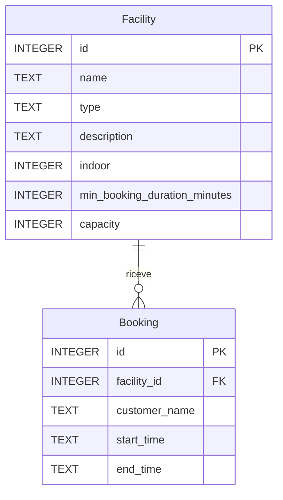

# Lezione 11 - Posti e responsabilità del backend

Fonte: ultima pagina di L11-slide.pdf. Sono richiesti Controller / Service / Repository, gestione della concorrenza e prenotazione di un posto per alcuni impianti invece dell’intero impianto.

## Decisioni minime

- `facilities.capacity`: 1 per calcio e tennis; 2 per piscina e palestra.
- Il valore 2 è un dato di esempio scelto perché le slide non forniscono capacità effettive. Non rappresenta la capienza reale di un centro sportivo.
- Una richiesta prenota sempre una sola unità: un posto negli impianti condivisi, l’intero impianto se capacity è 1. Nessuna quantità da inserire e nessuna nuova route.
- Per slot si intende l’intervallo inizio/fine già usato dal form. Non è stato introdotto un calendario di slot prefissati, la cui durata e i cui orari non sono specificati.
- Restano durata minima, intervalli futuri, orari UTC e adiacenze ammessi. Due intervalli sovrapposti sono accettabili finché c’è almeno un posto per tutta la richiesta.
- Il setup aggiunge capacity ai database esistenti senza cancellare impianti o prenotazioni. Solo per i due nomi iniziali Palestra Nord e Piscina Coperta imposta 2; gli altri impianti preesistenti ricevono 1. Gli avvii successivi non sovrascrivono il valore.
- Ogni riga di prenotazione conta un posto, comprese quelle salvate prima di questo incremento. Per piscina e palestra queste non riservano più tutto l’impianto. È una scelta esplicita per il modello minimo, senza aggiungere tipologie di prenotazione o campi per lo storico.

## Dove si trova il codice

- `backend/app.js`: crea e collega i componenti, configura Express e registra le route e la gestione errori già esistenti.
- `controllers/`: legge i parametri HTTP e scrive status/JSON.
- `services/`: valida i dati e decide se una prenotazione è ammissibile. Non usa request/response né contiene SQL.
- `repositories/`: query SQLite, conversione dei dati e confine della transaction. Non usa Express.

Il codice dei controlli preesistenti è stato spostato conservandone il comportamento. Per facilities il service è un passaggio breve, presente per seguire esplicitamente la struttura richiesta dalla lezione.

## Disponibilità e concorrenza

Invariante: in ogni istante i posti occupati di un impianto non superano `capacity`.

La creazione legge l’impianto e le prenotazioni che intersecano il nuovo intervallo; scrive una nuova prenotazione. Anche una riga che prima non esisteva può modificare l’insieme letto: le richieste sullo stesso impianto non sono indipendenti. Senza protezione, A e B potrebbero entrambe leggere un solo posto rimasto e poi salvarsi entrambe.

La sezione critica comprende lettura, controllo e inserimento. La transaction `immediate` preesistente rimane: acquisisce il lock di scrittura prima delle letture e coordina anche connessioni separate allo stesso file SQLite. Se il controllo rifiuta o l’inserimento fallisce, non si salva una prenotazione parziale. Le GET non richiedono una transaction esplicita.

Per contare i posti si calcola il picco degli intervalli sovrapposti. Non basta contarli tutti: due prenotazioni 10-11 e 11-12 occupano sempre un solo posto. A parità di orario si elaborano prima le uscite, poi gli ingressi, così resta valida la convenzione [inizio, fine).

## Contratto e modello

Le GET degli impianti aggiungono il numero `capacity` al JSON della Lezione 3. POST /bookings conserva input e risposta già documentati in [prenotazioni.md](prenotazioni.md). Per capienza esaurita restituisce 409, senza inserimento.

## Verifiche

19 test complessivamente superati con Node 22: i 18 test della suite precedente aggiornata, più il nuovo test di concorrenza fra due server su thread distinti, con connessioni separate allo stesso file temporaneo. Coprono:

- regressioni su input, durata, impianti, sovrapposizioni, adiacenze, rollback e persistenza;
- due posti accettati e terzo rifiutato per piscina e palestra;
- intervalli adiacenti che non vanno erroneamente sommati;
- due richieste per l’ultimo posto: una 201, una 409 e capienza rispettata, sia sul singolo server sia con connessioni separate;
- aggiornamento del vecchio schema senza perdita di righe e senza sovrascrivere capacity al secondo avvio;
- una regola del service verificata senza Express né SQLite.

Build frontend riuscita, con l’avviso già presente di React Router su `use client`. Nessuna nuova verifica manuale nel browser in questo incremento: nel frontend è cambiata soltanto l’indicazione «un posto»/«intero impianto» e il valore della capienza.

Il runner delle migrazioni, active e login restano alle lezioni successive. Lezioni 5 e 6 ignorate perché non disponibili; gli esercizi separati su banca/bici/fatture/prodotti non sono inclusi in SportHub.
